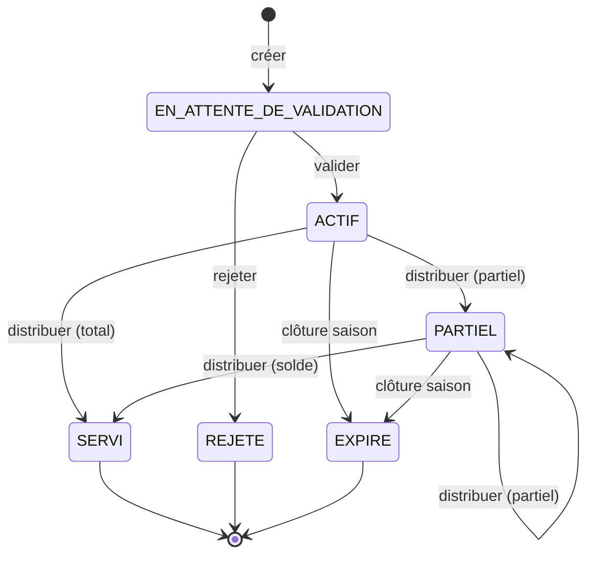

# Guide des diagrammes — Système FOMI-Stock

Ce document explique **chaque diagramme** du mémoire : ce qu'il montre, comment le lire,
ce qu'il faut dire à l'oral pour l'expliquer, et les points de vigilance.

Toutes les informations proviennent du **code réel** de `fomi-stock-api` (entités, services,
`SecurityConfig`, migrations SQL), pas du cahier des charges initial.

**Fichiers sources** : `memoire_assets/*.svg` (8 diagrammes, générés avec PlantUML, thème `materia-outline`).

---

## Table des matières

| # | Diagramme | Fichier | Type UML |
|---|---|---|---|
| 1 | [Diagramme de classes](#1-diagramme-de-classes) | `class_diagram.svg` | Structure |
| 2 | [Entité-Relation (modèle physique)](#2-diagramme-entité-relation) | `er_diagram.svg` | Données |
| 3 | [Séquence — Distribution FIFO](#3-séquence--distribution-fifo) | `sequence_distribution.svg` | Comportement |
| 4 | [Séquence — Création et validation d'un ticket](#4-séquence--création-et-validation-dun-ticket) | `sequence_ticket.svg` | Comportement |
| 5 | [Machine à états du ticket](#5-machine-à-états-du-ticket) | `ticket_state_machine.svg` | Comportement |
| 6 | [Cas d'utilisation](#6-diagramme-de-cas-dutilisation) | `use_case_diagram.svg` | Besoins |
| 7 | [Diagramme d'activités](#7-diagramme-dactivités) | `activity_diagram.svg` | Comportement |
| 8 | [Diagramme de déploiement](#8-diagramme-de-déploiement) | `deployment_diagram.svg` | Infrastructure |
| — | [Matrice RBAC exacte](#annexe-a--matrice-rbac-réelle) | — | Sécurité |
| — | [Incohérences connues](#annexe-b--incohérences-et-points-de-vigilance) | — | — |

---

## 1. Diagramme de classes

**Fichier** : `class_diagram.svg` — **Type** : diagramme de structure (UML).

### Objectif

Montrer les **14 entités métier** du système et leurs relations, avec leurs attributs
principaux et leurs méthodes métier.

### Comment le lire

- Chaque **boîte** = une entité JPA (`@Entity`), donc une table en base.
- Les **compartiments** vont du général au particulier : nom de la classe, puis attributs.
- Les **flèches** portent une **multiplicité** aux deux extrémités (`1`, `0..*`, `0..1`).
- Les **couleurs** regroupent les entités par domaine : localisation (vert), acteurs (jaune),
  stock (bleu), distribution (rose).

### Contenu (extrait du code réel)

| Domaine | Entités |
|---|---|
| Localisation | `Province`, `Zone`, `Colline` |
| Acteurs | `Agriculteur`, `Utilisateur` |
| Stock | `EngraisType`, `Lot`, `Depot`, `Stock`, `StockLot` |
| Distribution | `Ticket`, `Mouvement`, `Distribution` |
| Pilotage | `Alerte`, `SeuilAlerte`, `AuditLog` |

**Relations clés** :

- `Province 1 — 0..* Zone`, `Zone 1 — 0..* Colline` : découpage administratif du Burundi.
- `Colline 1 — 0..* Agriculteur` : chaque agriculteur est rattaché à une colline.
- `Agriculteur 1 — 0..* Ticket` : un agriculteur demande des tickets.
- `Ticket 1 — 0..* Distribution` : un ticket peut être servi en plusieurs fois (distributions partielles).
- `Lot 1 — 0..* Distribution` : chaque distribution sort d'un lot précis (traçabilité).
- `Mouvement 1 — 0..1 Distribution` : une distribution référence **exactement un** mouvement.
- `Utilisateur 0..1 — 0..* Depot/Zone/Province` : périmètre d'action d'un agent.

### À dire à l'oral

> « Ce diagramme présente le modèle objet du système. Trois remarques importantes.
> D'abord, `Distribution` est une entité à part de `Ticket` : c'est ce qui permet les
> **distributions partielles** et le suivi FIFO lot par lot. Ensuite, `StockLot` est la
> table qui rend le FIFO possible : elle stocke la quantité **par lot et par dépôt**, ce qui
> permet de savoir quel lot sortir en premier. Enfin, `Mouvement` porte une clé
> `idempotencyKey` unique, qui est notre garde-fou contre les doubles enregistrements. »

### Points de vigilance

- `Utilisateur` implémente `UserDetails` de Spring Security, mais le diagramme ne montre que
  les champs métier — c'est volontaire pour la lisibilité.
- `ANNULE` et `RECLAMATION` : `Mouvement.annule` est un **booléen**, pas un statut. Ne pas confondre.

---

## 2. Diagramme Entité-Relation

**Fichier** : `er_diagram.svg` — **Type** : modèle physique de données (notation patte d'oie).

### Objectif

Montrer la **structure exacte de la base PostgreSQL** : les 16 tables, leurs colonnes avec
types SQL, clés primaires (`PK`), clés étrangères (`FK`) et contraintes d'unicité.

### Comment le lire

C'est la différence essentielle avec le diagramme de classes :

| Diagramme de classes | Diagramme ER |
|---|---|
| Niveau **objet** (Java) | Niveau **table** (PostgreSQL) |
| Montre les types Java (`Long`, `String`) | Montre les types SQL (`BIGSERIAL`, `VARCHAR(50)`) |
| Montre les méthodes | Montre les contraintes (`UNIQUE`, `CHECK`) |

**Notation patte d'oie** :

```
||--o{   =  un vers plusieurs (0 ou plus)
||--||   =  un vers un exactement un
```

### Contenu (extrait du code réel)

**16 tables** : `province`, `zone`, `colline`, `depot`, `engrais_type`, `lot`, `stock`,
`stock_lot`, `agriculteur`, `ticket`, `utilisateur`, `mouvement`, `distribution`, `alerte`,
`seuil_alerte`, `audit_log`.

**Contraintes remarquables** :

- `UNIQUE (depot_id, engrais_type_id)` sur `stock` : une seule ligne de stock par couple dépôt/engrais.
- `UNIQUE (depot_id, lot_id)` sur `stock_lot` : un seul enregistrement par lot et par dépôt.
- `UNIQUE` sur `distribution.reference_mouvement_id` : c'est ce qui force la relation **1:1**.
- `CHECK (quantite_servie <= quantite_commandee)` sur `ticket` : la base elle-même interdit de servir plus que demandé.
- `CHECK (quantite_disponible >= 0)` sur `stock` : stock négatif impossible.
- `details_json` en **JSONB** dans `audit_log` (et non `TEXT`).
- **6 énumérations PostgreSQL natives** : `niveau_depot`, `statut_ticket`, `role_utilisateur`,
  `type_mouvement`, `type_alerte`, `niveau_alerte`.

### À dire à l'oral

> « Ce diagramme montre le modèle physique, c'est-à-dire le schéma tel qu'il existe dans
> PostgreSQL. L'important est la **défense en profondeur** : les règles métier sont protégées
> à trois niveaux — le contrôleur valide les entrées, le service applique la logique, et la
> base ajoute les contraintes `CHECK` et `UNIQUE`. Même un bug applicatif ne peut donc pas
> créer un stock négatif ou une quantité servie supérieure à la quantité commandée. »

### Points de vigilance

- Ce diagramme reflète l'état **après toutes les migrations** (`V1` à `V12`), c'est-à-dire
  l'état réel de production. Le fichier `V1__schema.sql` seul est incomplet
  (pas d'`email` sur `agriculteur`, pas de `seuil_alerte`, enums plus courts).
- Les enums ont évolué : `V1` déclarait 4 rôles, le code en compte **5** ; `V1` déclarait
  6 statuts de ticket, le code en compte **10**. C'est `V7__enums_validation_role.sql` qui a complété.

---

## 3. Séquence — Distribution FIFO

**Fichier** : `sequence_distribution.svg` — **Type** : diagramme de séquence (UML).
**Source** : `DistributionService.distribuer()` et `StockService.sortirFifo()`.

### Objectif

Montrer, **dans l'ordre chronologique**, ce qui se passe quand un agent distribue de l'engrais
à un agriculteur. C'est le flux le plus important du système.

### Comment le lire

- Les **colonnes verticales** (lignes de vie) = les composants : acteur, contrôleur, services, base.
- Le **temps descend** : chaque flèche est un appel de méthode.
- Une flèche **pleine** = appel ; une flèche **en pointillés** = retour de la méthode.
- Les **notes** expliquent les points non évidents.

### Déroulement (fidèle au code)

1. **Agent** → `DistributionController` : requête `POST /api/distributions`.
2. Le contrôleur appelle `DistributionService.distribuer()`.
3. **Verrou pessimiste** : `findByIdForUpdate(ticketId)` exécute un `SELECT ... FOR UPDATE`.
   Le ticket est verrouillé pour toute la durée de la transaction.
4. **Contrôle de périmètre** : `AGENT_COLLINE` ne peut distribuer que sur son propre dépôt ;
   `AGENT_ZONE` seulement dans sa zone.
5. **Contrôles métier** : statut du ticket autorisé, et quantité demandée ≤ restant.
6. **Sortie FIFO** : `StockService.sortirFifo()` sélectionne les lots par
   `ORDER BY lot.dateReceptionFomi ASC` — le lot **reçu en premier chez FOMI** sort en premier.
   Les lots **périmés** sont exclus avant la boucle.
7. Pour chaque lot sorti : création d'un `Mouvement` (type `DISTRIBUTION`) puis d'une `Distribution`.
8. Le ticket est mis à jour : `quantiteServie += quantite`, puis statut recalculé (`PARTIEL` ou `SERVI`).
9. Vérification des alertes, écriture du journal d'audit, notification email à l'agriculteur.
10. Tout est dans **une seule transaction** (`@Transactional`) : si une étape échoue, tout est annulé.

### À dire à l'oral

> « C'est le diagramme central du mémoire. Trois choses à retenir.
> **Premièrement**, le verrou pessimiste `SELECT FOR UPDATE` : il empêche deux agents de
> servir le même ticket en même temps, ce qui provoquerait une double distribution.
> **Deuxièmement**, le FIFO n'est pas basé sur la date de fabrication mais sur la date de
> **réception chez FOMI** — c'est un choix métier : on veut écouler le stock présent en dépôt
> le plus ancien, en écartant les lots périmés.
> **Troisièmement**, une distribution partielle est normale : le ticket passe à `PARTIEL`
> et reste servi en plusieurs fois. »

### Points de vigilance

- La notification email est **non bloquante** : si le SMTP est injoignable, la distribution
  réussit quand même (mode dégradé volontaire).
- Le tri FIFO est un tri **base de données** (`OrderBy...Asc`), pas un tri Java : c'est plus
  performant et cohérent.

---

## 4. Séquence — Création et validation d'un ticket

**Fichier** : `sequence_ticket.svg` — **Type** : diagramme de séquence (UML).
**Source** : `TicketService.creer()`, `activer()` et `rejeter()`.

### Objectif

Montrer le parcours d'un ticket, de sa création jusqu'à sa validation, en insistant sur les
**règles métier** appliquées.

### Comment le lire

Deux parties séparées par un trait : **Création** (agent colline → système) et
**Validation** (agent zone → système). Les règles métier sont regroupées dans une **note**,
plutôt que dispersées en cadres imbriqués — choix de lisibilité.

### Les règles métier appliquées (réelles)

| Règle | Contenu | Où dans le code |
|---|---|---|
| **R22 — plafond** | `quantité ≤ superficie × 150 kg/ha` | `TicketService.creer()` |
| **R22 — cumul** | Somme des tickets actifs de la saison + nouvelle quantité ≤ plafond | idem |
| **R6 — unicité** | Un seul ticket par agriculteur + saison + type d'engrais | idem |
| **Unicité numéro** | `numeroTicket` non déjà utilisé | idem |

**Statut initial** : `EN_ATTENTE_DE_VALIDATION` — et c'est important : ce n'est **pas** `PAYE`,
même si l'entité déclare `PAYE` par défaut. Le service force la valeur.

### À dire à l'oral

> « Ce diagramme montre l'application des règles métier. La règle R22 est la plus
> intéressante : le plafond d'engrais n'est pas un chiffre fixe, il est **calculé** à partir
> de la superficie déclarée de l'agriculteur, à raison de 150 kg par hectare. Et ce n'est pas
> contrôlé ticket par ticket, mais en **cumul** sur toute la saison : c'est ce qui empêche un
> agriculteur de contourner le quota en créant plusieurs tickets. La règle R6 interdit en plus
> deux tickets pour la même saison et le même engrais. »

### Points de vigilance

- **Le diagramme indique « agent zone valide »** — or `SecurityConfig` réserve en réalité
  `PATCH .../activer` et `.../rejeter` aux rôles **`ADMIN` et `SUPERVISEUR`**. Voir
  [Annexe B](#annexe-b--incohérences-et-points-de-vigilance).
- Après validation, un email part automatiquement (`TICKET_VALIDE`).

---

## 5. Machine à états du ticket

**Fichier** : `ticket_state_machine.svg` — **Type** : diagramme d'états-transitions (UML).
**Source** : `StatutTicket.java` et `Ticket.mettreAJourStatut()`.

### Objectif

Montrer tous les états possibles d'un ticket et les transitions autorisées entre eux.

### Comment le lire

- Le **rond noir plein** = état initial. Le **rond cerclé** = état final.
- Les **flèches** sont des transitions, étiquetées par l'action qui les déclenche.
- Une **boucle** (flèche qui revient sur l'état) = une distribution partielle supplémentaire.

### Diagramme simplifié



### Transitions réelles

| Depuis | Vers | Déclencheur | Code |
|---|---|---|---|
| — | `EN_ATTENTE_DE_VALIDATION` | création | `creer()` |
| `EN_ATTENTE_DE_VALIDATION` | `ACTIF` | validation | `activer()` |
| `EN_ATTENTE_DE_VALIDATION` | `REJETE` | rejet | `rejeter()` |
| `ACTIF` | `PARTIEL` | distribution partielle | `mettreAJourStatut()` |
| `ACTIF` | `SERVI` | distribution totale | `mettreAJourStatut()` |
| `PARTIEL` | `SERVI` | distribution du solde | `mettreAJourStatut()` |
| `ACTIF` / `PARTIEL` | `EXPIRE` | clôture de saison | `expirerTickets()` |
| Toute modification | `EN_ATTENTE_DE_VALIDATION` | `modifier()` | remet le ticket en attente |

### À dire à l'oral

> « La logique de calcul du statut est dans la méthode `mettreAJourStatut()`. Elle commence par
> un **garde-fou** : si le ticket est déjà `ANNULE`, `RECLAMATION`, `REJETE` ou `EXPIRE`, la
> méthode ne fait rien — ces états sont considérés comme terminaux. Ensuite, si rien n'a été
> servi, le statut ne change pas ; sinon il devient `SERVI` si tout est servi, `PARTIEL` sinon.
> Un point important : **modifier un ticket le renvoie systématiquement en attente de
> validation** — c'est une mesure de contrôle. »

### Points de vigilance

- **`ANNULE` et `RECLAMATION` ne sont jamais atteints** dans le code actuel : ils existent dans
  l'énumération et sont testés, mais aucune méthode ne les assigne. Le diagramme les omet
  volontairement pour ne pas laisser croire qu'ils sont fonctionnels.
- Un ticket `EXPIRE` conserve ses distributions passées : l'expiration ne détruit rien.

---

## 6. Diagramme de cas d'utilisation

**Fichier** : `use_case_diagram.svg` — **Type** : diagramme de cas d'utilisation (UML).

### Objectif

Montrer **qui** (acteurs) peut faire **quoi** (cas d'utilisation) dans le système. C'est le
diagramme des besoins fonctionnels, vu de l'extérieur.

### Comment le lire

- Les **bonhommes-bâtons** = acteurs (rôles ou utilisateurs externes).
- Les **ellipses** = cas d'utilisation (une action métier complète, pas une méthode technique).
- Le **cadre rectangulaire** = frontière du système.
- Les flèches en **pointillés `«include»`** = un cas en inclut toujours un autre.

### Les 5 rôles réels du système

| Rôle | Description |
|---|---|
| `ADMIN` | Administrateur : gère utilisateurs, engrais, dépôts, seuils |
| `SUPERVISEUR` | Supervise : statistiques, audit, clôture de saison, distribution |
| `AGENT_ZONE` | Agent de zone : crée et modifie les tickets, distribue |
| `AGENT_COLLINE` | Agent de colline : crée les tickets, distribue sur son dépôt |
| `AGENT_LOGISTIQUE` | Gère la réception des lots |

**Plus un acteur externe** : l'**Agriculteur**, qui n'a **pas de compte**. Il consulte son
ticket via `GET /api/public/tickets/{numero}`, sans authentification.

### À dire à l'oral

> « Deux points différencient ce diagramme d'un diagramme classique.
> **Premièrement**, l'agriculteur n'est pas un utilisateur authentifié : il n'a ni compte ni
> mot de passe. Il consulte son ticket par son numéro, via un point d'entrée public — c'est
> une contrainte forte du cahier des charges, car beaucoup d'agriculteurs n'ont pas de
> smartphone. **Deuxièmement**, le système compte 5 rôles, dont un rôle purement logistique
> qui gère la réception des lots chez FOMI. »

### Points de vigilance

- **Attention** : ce diagramme représente l'**intention fonctionnelle**, et les associations
  acteur ↔ cas sont **simplifiées**. La vérité exacte est dans `SecurityConfig` —
  voir [Annexe A](#annexe-a--matrice-rbac-réelle). En cas de contradiction, **c'est l'annexe A qui fait foi**.
- L'authentification est un cas transversal : elle est incluse par les autres fonctionnalités
  plutôt que reliée à chaque acteur par une flèche (choix de lisibilité).

---

## 7. Diagramme d'activités

**Fichier** : `activity_diagram.svg` — **Type** : diagramme d'activités (UML), en couloirs.
**Source** : `TicketService`, `DistributionService`, `AlerteService`.

### Objectif

Montrer le **cycle de vie complet** d'un ticket, du premier contact de l'agriculteur jusqu'à
la clôture de la saison, en indiquant **qui** fait chaque étape.

### Comment le lire

- Les **colonnes** = les couloirs (*swimlanes*) : Agriculteur, Agent colline, Système, Agent zone.
- On suit le flux de **haut en bas** ; changer de couloir = changer d'acteur.
- Les **losanges** = décisions (embranchements).
- Le **rond plein** = début ; le **rond cerclé** = fin.

### Étapes du flux

1. **Agriculteur** : demande un ticket au dépôt de colline.
2. **Agent colline** : enregistre et crée la demande.
3. **Système** : vérifie les règles R22 (plafond et cumul) et R6 (unicité).
4. **Décision** : si non conforme → refus. Si conforme → enregistrement en `EN_ATTENTE_DE_VALIDATION`.
5. **Agent zone** : examine la demande.
6. **Décision** : validée → `ACTIF` ; refusée → `REJETE`.
7. **Distribution** : sortie FIFO des lots, mise à jour du stock, enregistrement du mouvement.
8. **Décision** : tout servi → `SERVI` ; sinon → `PARTIEL` (et attente d'un nouveau retrait).
9. **Clôture de saison** : les tickets non entièrement servis passent à `EXPIRE`.

### À dire à l'oral

> « L'intérêt des couloirs est de montrer **la séparation des responsabilités**. L'agriculteur
> ne fait que demander ; l'agent de colline enregistre ; l'agent de zone valide ; le système
> exécute les règles et le FIFO. On voit aussi que le parcours n'est pas linéaire : un ticket
> peut rester `PARTIEL` plusieurs semaines, jusqu'à ce que l'agriculteur revienne chercher le
> reste — et s'il ne revient pas avant la clôture, le ticket expire. »

### Points de vigilance

- Ce diagramme **mélange deux niveaux** : le parcours métier (visible par les acteurs) et des
  détails techniques (`mouvement`, FIFO). C'est un choix assumé pour la complétude ; une
  variante plus courte est possible si l'encadrant préfère.

---

## 8. Diagramme de déploiement

**Fichier** : `deployment_diagram.svg` — **Type** : diagramme de déploiement (UML).
**Source** : `Dockerfile`, `application-dev.yml`, `application-prod.yml`, `ci.yml`.

### Objectif

Montrer **où tourne quoi** : les machines, conteneurs et services, et comment ils communiquent.

### Comment le lire

- Les **nœuds 3D** = machines physiques ou virtuelles (poste client, serveur, CI).
- Les **cylindres** = bases de données.
- Le **nuage** = service externe.
- Les **flèches** = protocoles de communication (HTTPS, JDBC, SMTP).

### Contenu (réel)

| Composant | Détail | Source |
|---|---|---|
| Frontend | React + Vite, port 5173 en dev | `fomi-stock-web` |
| Mobile | Expo / React Native (prévu) | `fomi-stock-mobile` |
| API | Spring Boot 3.3.5, Java 21, port 8080 | `application.yml` |
| Conteneur | `maven:3.9-eclipse-temurin-21` (build) → `eclipse-temurin:21-jre` (run) | `Dockerfile` |
| Base | PostgreSQL 16, `fomi_stock` | `application-dev.yml` |
| Migrations | Flyway, `classpath:db/migration` | `application-prod.yml` |
| SMTP | Mailpit en local, port 1025 | `application.yml` |
| CI | GitHub Actions, `ubuntu-24.04`, JDK 21, `mvn -B verify` | `ci.yml` |

**En production**, la base est configurée par variables d'environnement
(`DB_URL`, `DB_USERNAME`, `DB_PASSWORD`), et le port par `PORT`. Le fuseau horaire est forcé à
`Africa/Bujumbura` — important pour un système burundais.

### À dire à l'oral

> « Le déploiement est **conteneurisé** : le `Dockerfile` est multi-étapes, ce qui est une
> bonne pratique — l'image finale ne contient que le JRE et le `.jar`, pas Maven ni le code
> source, donc elle est plus légère et plus sûre. En production, aucun identifiant n'est écrit
> dans le code : la base est configurée par variables d'environnement. Enfin, Flyway applique
> les migrations **automatiquement au démarrage**, et Hibernate est en mode `validate`
> seulement — c'est Flyway qui fait foi sur le schéma, pas Hibernate. »

### Points de vigilance

- **Aucune configuration de déploiement cloud** n'a été trouvée dans le dépôt (pas de
  `railway.json`, `fly.toml`, etc.). Le diagramme reste donc générique côté hébergeur.
- Le fuseau `Africa/Bujumbura` (UTC+2) est défini **trois fois** : `Dockerfile`, Hibernate
  (`application-prod.yml`), et l'OS. C'est volontaire, mais à connaître.

---

## Annexe A — Matrice RBAC réelle

⚠️ **C'est la source de vérité** : extraite de `SecurityConfig.java`, ligne par ligne. En cas de
contradiction avec le diagramme de cas d'utilisation, **cette table gagne**.

### Points d'entrée publics (sans authentification)

| Endpoint | Détail |
|---|---|
| `POST /api/auth/login` | Connexion |
| `GET /actuator/health` | Sonde de santé |
| `/api-docs/**`, `/swagger-ui/**` | Documentation Swagger |
| `/api/public/**` | Consultation d'un ticket par numéro |

### Endpoints protégés

| Endpoint | Rôles autorisés |
|---|---|
| `GET /api/statistiques/**` | `ADMIN`, `SUPERVISEUR` |
| `GET /api/alertes/**` | `ADMIN`, `SUPERVISEUR`, `AGENT_ZONE`, `AGENT_COLLINE` |
| Autres `/api/alertes/**` (traiter) | `ADMIN` |
| `/api/utilisateurs/**` | `ADMIN` |
| `GET /api/audit-logs/**` | `ADMIN` |
| `POST /api/mouvements/reception` | `ADMIN`, `AGENT_LOGISTIQUE` |
| `POST /api/mouvements/transfert` | `ADMIN` |
| Autres `/api/mouvements/**` | tout utilisateur authentifié |
| `POST /api/mouvements/*/annuler` | `ADMIN`, `SUPERVISEUR` |
| `PUT /api/tickets/**` | `ADMIN`, `AGENT_ZONE` |
| `PATCH /api/tickets/*/activer` | **`ADMIN`, `SUPERVISEUR`** |
| `PATCH /api/tickets/*/rejeter` | **`ADMIN`, `SUPERVISEUR`** |
| `POST /api/tickets` | `ADMIN`, `AGENT_ZONE`, `AGENT_COLLINE` |
| `POST /api/tickets/expirer` | `ADMIN`, `SUPERVISEUR` |
| `POST /api/distributions` | `ADMIN`, `SUPERVISEUR`, `AGENT_ZONE`, `AGENT_COLLINE` |
| `POST /api/lots/**` | `ADMIN`, `AGENT_LOGISTIQUE` |
| `GET /api/lots/**` | `ADMIN`, `AGENT_ZONE`, `AGENT_COLLINE`, `SUPERVISEUR`, `AGENT_LOGISTIQUE` |
| `GET /api/export/**` | `ADMIN`, `SUPERVISEUR`, `AGENT_ZONE`, `AGENT_LOGISTIQUE` |
| `POST`/`PUT` `/api/depots/**` | `ADMIN` |
| `POST`/`PUT` `/api/agriculteurs/**` | `ADMIN`, `AGENT_ZONE`, `AGENT_COLLINE` |
| `GET /api/engrais-types/**` | authentifié |
| `POST`/`PUT`/`DELETE` `/api/engrais-types/**` | `ADMIN` |
| `GET /api/seuils-alerte/**` | authentifié |
| `POST`/`PUT`/`DELETE` `/api/seuils-alerte/**` | `ADMIN` |

### Règles métier sur les rôles (dans `DistributionService`)

- `AGENT_COLLINE` : ne peut distribuer que **sur son propre dépôt**.
- `AGENT_ZONE` : ne peut distribuer que **dans sa zone**.
- Ces contrôles sont **en plus** du RBAC : un agent ne peut pas distribuer sur un dépôt hors
  de son périmètre même s'il a le rôle autorisé.

---

## Annexe B — Incohérences et points de vigilance

Points relevés en comparant les diagrammes, `SecurityConfig`, le code et les migrations.
**À connaître avant la soutenance** : mieux vaut les maîtriser que se les voir signaler.

### 1. Validation des tickets : diagramme vs RBAC

- **Le diagramme de cas d'utilisation** associe la validation au rôle `AGENT_ZONE`.
- **`SecurityConfig`** réserve `activer` et `rejeter` à **`ADMIN` et `SUPERVISEUR`**.
- **Le texte du rapport** (`canevas_fixfacts.py`) peut encore citer un agent provincial.
- ➜ **Décision à prendre** : soit corriger le diagramme, soit assumer le diagramme comme
  intention fonctionnelle et s'appuyer sur l'annexe A. Il ne faut **pas** laisser les deux se
  contredire dans le même document.

### 2. Transfert de stock

- **Le diagramme** suggère que l'agent logistique transfère du stock.
- **`SecurityConfig`** réserve `POST /api/mouvements/transfert` à **`ADMIN` seul**.
- ➜ La réception, en revanche, est bien partagée `ADMIN` / `AGENT_LOGISTIQUE`.

### 3. Statuts jamais atteints

- `ANNULE` et `RECLAMATION` figurent dans `StatutTicket` mais **aucun code ne les assigne**.
- `PAYE` et `EN_ATTENTE` sont acceptés par `DistributionService` comme statuts distribuables,
  mais seul `PAYE` est la valeur par défaut de l'entité — reliquat historique.
- ➜ Si ces statuts apparaissent dans d'autres figures du mémoire, ils sont inexacts.

### 4. Compteurs (valeurs divergentes selon les fichiers)

| Donnée | Valeur **réelle** (code) | Où c'est faux |
|---|---|---|
| Tests (`@Test`) | **218** | `canevas_fixfacts.py` (207), `generate_docx.py` (203) |
| Repositories | **16** | `generate_docx.py` (15) |
| Migrations | **12** (`V1`→`V12`) | `canevas_fixfacts.py` (11), `generate_docx.py` (11) |
| Tables | **16** | correct partout |
| Contrôleurs | **17** | correct |
| Endpoints | **62** mappings | `canevas_fixfacts.py` (60) |

➜ **Les diagrammes sont à jour, le texte du rapport ne l'est pas.** C'est la correction la
plus urgente à faire avant la remise.

### 5. Fichiers obsolètes dans le dépôt

`test_syntax.py` et `test_parse.py` sont d'**anciennes copies** de `generate_memoire.py`,
figées à 203 tests / 15 repositories / 11 migrations. Si quelqu'un les exécute, ils écrasent
les diagrammes à jour par des versions périmées. ➜ À supprimer ou à neutraliser.

### 6. Bugs relevés dans `AlerteService`

- **Nom de variable trompeur** : `LocalDateTime ilYADixSeptJours = LocalDateTime.now().minusDays(7);`
  — la variable dit « 17 jours » mais la valeur est **7 jours**.
- **Doublons possibles d'alertes `INACTIVITE`** : quand `engraisType` est `null`, la
  vérification d'unicité (`existe`) est court-circuitée à `false`, donc une **nouvelle alerte
  est créée à chaque exécution** du planificateur.
  ➜ Ces deux points sont dans le **code**, pas dans les diagrammes, mais un jury attentif peut
  les poser en question.

### 7. Tâches planifiées (réelles)

| Heure | Méthode | Rôle |
|---|---|---|
| 06h00 | `scheduledDelais()` | Alerte `DELAI_DEPASSE` pour les tickets non servis depuis **30 jours** |
| 06h30 | `scheduledInactivite()` | Alerte `INACTIVITE` pour les dépôts sans mouvement depuis **7 jours** |

➜ Le diagramme de déploiement ne montre pas ces tâches ; si tu veux les intégrer, il faut
indiquer que l'API exécute elle-même ces jobs (pas de serveur de tâches externe).

---

## Annexe C — Régénérer les diagrammes

Les sources PlantUML ne sont pas versionnées dans ce dépôt. Pour modifier un diagramme :

1. Récupérer la source (elle a été utilisée pour produire le SVG correspondant).
2. La coller sur [plantuml.com/plantuml](https://www.plantuml.com/plantuml).
3. Cliquer sur **SVG**.
4. Télécharger via PowerShell :

```powershell
Invoke-WebRequest -Uri "https://www.plantuml.com/plantuml/svg/XXXX" `
  -OutFile "memoire_assets\nom_du_diagramme.svg" -UseBasicParsing
```

**En cmd**, utiliser `curl -L -o "memoire_assets\nom.svg" "URL"`.

**Thème commun** à tous les diagrammes (à conserver pour l'homogénéité) :

```plantuml
!theme materia-outline
skinparam shadowing true
skinparam roundCorner 12
skinparam DefaultFontName "Segoe UI"
skinparam ArrowColor #607D8B
```

**Insertion dans Word** : `Insertion` → `Images` → `Cet appareil` → sélectionner le `.svg`.
Word 2016+ gère nativement le SVG.

---

## Récapitulatif pour la soutenance

| Si on te demande… | Réponds… |
|---|---|
| Le cœur technique du système | La séquence de distribution FIFO avec verrou pessimiste |
| Comment tu garantis l'intégrité | Triple protection : contrôleur, service, contraintes SQL |
| Comment tu évites la double distribution | `SELECT ... FOR UPDATE` + clé d'idempotence |
| Pourquoi FIFO par date de réception | Choix métier : écouler le stock le plus ancien en dépôt |
| Comment l'agriculteur suit sa commande | Endpoint public, sans compte, par numéro de ticket |
| Pourquoi les distributions partielles | `Distribution` séparée de `Ticket`, statut `PARTIEL` |
| Ce que tu améliorerais | Corriger les doublons d'alertes, ajouter les statuts `ANNULE`/`RECLAMATION` |
